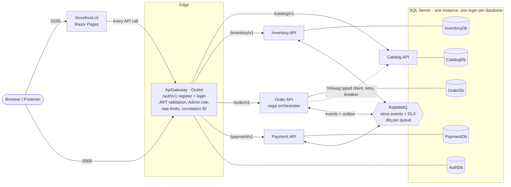
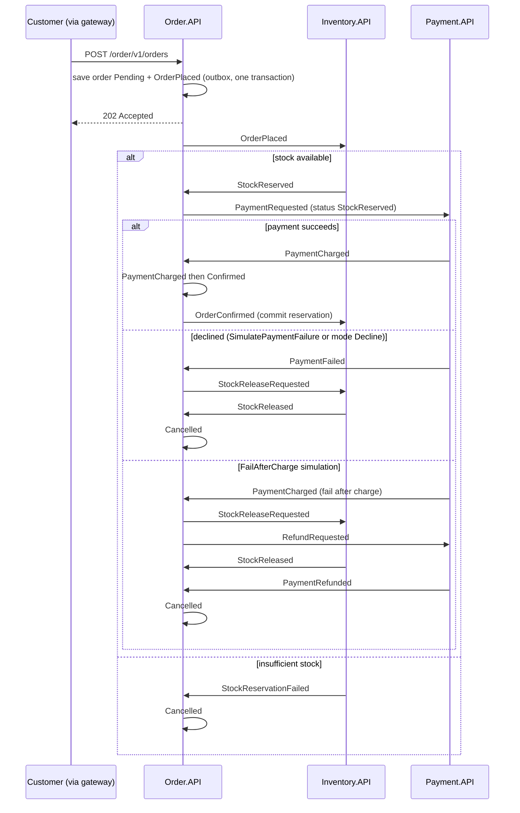

# Online Store Platform

A containerized, event-driven microservices store for the Advanced System Integration and Architecture capstone. It has four services (Catalog, Inventory, Order, Payment) and a Storefront UI, all behind an Ocelot API gateway that issues and validates JWTs. Placing an order runs an orchestrated saga over RabbitMQ: reserve stock, charge payment, confirm. On failure it compensates: release the stock, refund if already charged, cancel.

## Architecture



### Order saga



Every step is one local transaction in the service's own database. Every status change is written to `OrderStatusHistory`.

### How the modules map to the code

| Module | Where |
|---|---|
| 2: Contract-first API | `contracts/*.yaml` (committed before the controllers). NSwag clients are generated at build time (`OpenApiReference` in Order.API and Storefront.UI). Routes are versioned with `Asp.Versioning` (`/catalog/v1/...`), and each service has its own Swagger UI. Problem Details come from `Store.Shared.Common/Exceptions`. |
| 3: Synchronous integration | Order → Catalog uses the generated client registered with `AddStoreTypedClient` (retry with exponential backoff and jitter, per-attempt and total timeouts, circuit breaker). `CatalogGateway` translates 404 to null and failures to `DownstreamServiceException`. Correlation ID: `CorrelationIdMiddleware` plus `CorrelationIdDelegatingHandler`, carried in message headers. A dev-only chaos switch is at `/chaos`. |
| 4: Event-driven integration | `Store.Shared.Events`: event records, publisher confirms, `BackgroundService` consumers with manual ack, the `ProcessedMessages` guard, and a DLX with a `.dlq` per queue. Publishing goes through a transactional outbox (`OutboxMessages`). |
| 5: Data & consistency | One SQL Server database per service with its own login. EF Core migrations and seed data are applied at startup. The saga lives in `Order.API/Saga/OrderSaga.cs`. |
| 6: Containerization | A multi-stage `Dockerfile` per project. One `docker-compose.yml` with SQL Server, RabbitMQ, all services, the gateway and the Storefront, with health checks and volumes. |
| 8: Gateway & security | `src/Gateway/ApiGateway`: `ocelot.json`, JWT validated at the edge, the Admin role check, ASP.NET Core Identity in AuthDb, and rate limits. |

## Prerequisites

- Docker Desktop (or Docker Engine) with Compose v2, and about 6 GB of free RAM. SQL Server alone needs about 2 GB.
- To create migrations and work on the code: the .NET 10 SDK and the EF Core CLI: `dotnet tool install --global dotnet-ef --version 10.0.13`.
- Apple Silicon: SQL Server has no ARM image. Turn on "Use Rosetta for x86_64/amd64 emulation" in Docker Desktop.

## Run it

```bash
git clone <repo-url>
cd OnlineStorePlatform
cp .env.example .env                 # PowerShell: Copy-Item .env.example .env
# one-time, then commit the Migrations folders (see "Database migrations")
docker compose up --build
```

The first build takes several minutes. Once `docker compose ps` shows `api-gateway` and `storefront` as `healthy`:

| What | URL |
|---|---|
| Storefront | http://localhost:5100 |
| API gateway | http://localhost:5000 (try `curl http://localhost:5000/catalog/v1/products`) |
| Auth contract (Swagger UI) | http://localhost:5000/swagger |
| RabbitMQ management | http://localhost:15672 (guest / guest) |
| SQL Server (SSMS / Azure Data Studio) | `localhost,14333`, user `sa`, password from `.env` |

To stop, press `Ctrl+C` or run `docker compose down`. Data persists in the `sqlserver-data` and `rabbitmq-data` volumes. `docker compose down -v` deletes them, and the next start recreates and reseeds everything.

### Demo accounts

These are seeded into AuthDb from `.env`:

| Role | Email | Password |
|---|---|---|
| Admin | `admin@store.local` | `Admin12345` |
| Customer | `customer@store.local` | `Customer12345` |

New sign-ups (`POST /auth/v1/register`, or Register in the Storefront) always get the Customer role.

## Port map

| Component | Inside `store-net` | On the host |
|---|---|---|
| api-gateway | `api-gateway:8080` | **5000** |
| storefront | `storefront:8080` | **5100** |
| catalog-api / inventory-api / order-api / payment-api | `<name>:8080` | not published |
| rabbitmq | `rabbitmq:5672` (AMQP), `:15672` (UI) | **15672** (UI only) |
| sqlserver | `sqlserver:1433` | **14333** (admin and verification only) |

To reach a service directly, for example its Swagger UI or chaos endpoint, go through its container:

```bash
docker compose exec catalog-api curl -s http://localhost:8080/health
```

## Database design

There is one SQL Server instance with five databases. `DatabaseScripts/00_CreateDatabasesAndLogins.sql` runs in the one-shot `sqlserver-init` container. It creates the databases and one login per service. Each login is `db_owner` of its own database and has no user in any other, so database-per-service is enforced by permissions. There are no cross-database foreign keys. IDs such as `ProductId` and `OrderId` are passed by value through APIs and events.

| Database (owner, login) | Tables | Notes |
|---|---|---|
| **CatalogDb** (Catalog.API, `catalog_svc`) | `Products` | Unique `Name`, `decimal(18,2)` price with check ≥ 0, `IsActive` soft delete, `rowversion`. 10 seeded products. |
| **InventoryDb** (Inventory.API, `inventory_svc`) | `Inventory`, `StockReservations`, `ProcessedMessages`, `OutboxMessages` | Check constraints keep `QuantityReserved ≤ QuantityOnHand`, both ≥ 0. `rowversion`. Unique `(OrderId, ProductId)` on reservations stops double reservations. Status `Reserved → Released/Committed` stops double releases. FK reservations → inventory, `Restrict`. Seeded stock for the 10 products. |
| **OrderDb** (Order.API, `order_svc`) | `Orders`, `OrderItems`, `OrderStatusHistory`, `ProcessedMessages`, `OutboxMessages` | Statuses `Pending, StockReserved, PaymentCharged, Confirmed, Cancelled`, plus a `SagaStep`. `SimulatePaymentFailure`. Price and name snapshotted per item. FKs items/history → orders, `Cascade`. `rowversion` on orders. |
| **PaymentDb** (Payment.API, `payment_svc`) | `Payments`, `Refunds`, `PaymentSettings`, `ProcessedMessages`, `OutboxMessages` | Unique `OrderId` (one charge per order). Unique `Refunds.PaymentId` (one refund per payment). FK refunds → payments, `Restrict`. `PaymentSettings` holds the failure-simulation mode (single row). |
| **AuthDb** (ApiGateway, `auth_svc`) | ASP.NET Core Identity: `AspNetUsers`, `AspNetRoles`, `AspNetUserRoles`, `AspNetUserClaims`, `AspNetUserLogins`, `AspNetUserTokens`, `AspNetRoleClaims` | Owned by the gateway because the gateway hosts register/login and signs the JWTs. Services never read it: they learn the caller from the validated token (`X-User-*` headers). Roles Admin and Customer, plus the demo users, are seeded at startup. |

All timestamps are `datetime2` in UTC (`CreatedAtUtc`, `UpdatedAtUtc`). Status columns are `varchar`, IDs are `uniqueidentifier`, money is `decimal(18,2)`. `ProcessedMessages` has a unique index on `(EventId, ConsumerName)`. `OutboxMessages` has `EventId` (unique), `EventType`, `Payload`, `Status`, `RetryCount`, `CreatedAtUtc` and `ProcessedAtUtc`.

### Database migrations

EF Core migrations own every table. The seed data (`HasData`) for products, stock and payment settings is part of each initial migration. Each service applies its own migrations at startup (`InitializeDatabaseAsync`). Nothing is ever dropped.

Create the initial migrations once, from the repository root, then commit the generated `Data/Migrations` folders:

```bash
dotnet tool install --global dotnet-ef --version 10.0.13   # once
dotnet ef migrations add InitialCatalogCreate   --project src/Services/Catalog.API   --context CatalogDbContext   --output-dir Data/Migrations
dotnet ef migrations add InitialInventoryCreate --project src/Services/Inventory.API --context InventoryDbContext --output-dir Data/Migrations
dotnet ef migrations add InitialOrderCreate     --project src/Services/Order.API     --context OrderDbContext     --output-dir Data/Migrations
dotnet ef migrations add InitialPaymentCreate   --project src/Services/Payment.API   --context PaymentDbContext   --output-dir Data/Migrations
dotnet ef migrations add InitialAuthCreate      --project src/Gateway/ApiGateway     --context AuthDbContext      --output-dir Data/Migrations
```

These commands don't need a database: each project has an `IDesignTimeDbContextFactory`. To get a SQL script of a migration for review, use `dotnet ef migrations script --project src/Services/Order.API --context OrderDbContext`. The CI workflow fails while any context has no migration, or when the model has changed without a new one (`has-pending-model-changes`).

If you start the system before adding migrations, each service logs a warning and creates its schema with `EnsureCreated`, so it still runs. That schema has no migration history. After adding the migrations, reset once with `docker compose down -v`.

### Verifying the databases

```bash
docker compose exec sqlserver bash -c '/opt/mssql-tools18/bin/sqlcmd -S localhost -U sa -P "$MSSQL_SA_PASSWORD" -C -i /scripts/99_VerifyDatabases.sql'
```

`DatabaseScripts/99_VerifyDatabases.sql` is read-only. It lists the five databases and their logins, applied migrations, tables, unique indexes, foreign keys and seed counts. It also shows the latest orders with their status history, payments with refunds, reservations (Released rows show that compensation restored stock), `ProcessedMessages` per consumer, and the outbox state. It finishes with a duplicate check that should return no rows.

To show ownership is enforced, this fails with a login error, because `catalog_svc` cannot open OrderDb:

```bash
docker compose exec sqlserver bash -c '/opt/mssql-tools18/bin/sqlcmd -S localhost -U catalog_svc -P "Catalog#Dev2026" -C -d OrderDb -Q "SELECT 1"'
```

## Gateway and security

The gateway serves `/auth/v1/*` itself. Everything else is forwarded by Ocelot to the same path on the service.

| Method | Path | Access |
|---|---|---|
| POST | `/auth/v1/register`, `/auth/v1/login` | Public, rate-limited (5/min per client) |
| GET | `/auth/v1/me` | Logged in |
| GET | `/catalog/v1/products`, `/catalog/v1/products/{id}` | Public |
| POST / PUT / DELETE | `/catalog/v1/products`, `/catalog/v1/products/{id}` | **Admin** |
| GET | `/inventory/v1/stock`, `/inventory/v1/stock/{productId}` | Public |
| PUT | `/inventory/v1/stock/{productId}` | **Admin** |
| GET | `/inventory/v1/reservations/{orderId}` | **Admin** |
| POST | `/order/v1/orders` | Logged in, rate-limited (30/min, Ocelot `RateLimitOptions`) |
| GET | `/order/v1/orders`, `/order/v1/orders/{id}` | Logged in (customers see their own orders, Admins see all) |
| GET | `/payment/v1/payments/{orderId}` | Logged in |
| GET / PUT | `/payment/v1/simulation` (payment-failure switch) | Logged in |

- **401**: no token, an expired token, or a token not signed with `JWT_KEY` or with the wrong issuer/audience.
- **403**: a valid token without the `Admin` role on an admin route (Ocelot `RouteClaimsRequirement`).
- **429**: rate limit exceeded. The response includes `Retry-After`.
- Every rejection is `application/problem+json` and includes `correlationId`.
- On protected routes the gateway forwards the caller as `X-User-Id`, `X-User-Role` and `X-User-Email`, taken from the token. Any copies a client sends are stripped first.
- Passwords are hashed by ASP.NET Core Identity. Five failed logins lock the account for 5 minutes.

## Triggering the failure on demand

Graders don't need to edit code or stop a service. There are two ways:

1. **Per order**: tick "Simulate payment failure" at checkout, or send `"simulatePaymentFailure": true` with `POST /order/v1/orders`. Payment declines, the stock is released, and the order ends **Cancelled**. Nothing was charged, so there is no refund.
2. **Global switch**: use the Storefront's "Payment simulation" page, or `PUT /payment/v1/simulation` with `{"mode": "..."}`:
   - `None`: payments succeed.
   - `Decline`: every payment is declined, as in option 1.
   - `FailAfterCharge`: the charge succeeds, then the order fails. The saga **refunds** the payment (a row in `Refunds`) and releases the stock. Use this to show the full compensation.

The order page refreshes every 2 seconds and shows the whole status history.

## Correlation IDs, resilience and chaos

The gateway, or the Storefront for UI traffic, creates `X-Correlation-ID`. Every service logs it on every line, typed clients pass it on, and RabbitMQ messages carry it in the `x-correlation-id` header. `OrderStatusHistory.CorrelationId` stores it too.

```bash
curl -s -X POST http://localhost:5000/order/v1/orders -H "Authorization: Bearer <token>" \
     -H "Content-Type: application/json" -H "X-Correlation-ID: demo-trace-42" \
     -d '{"items":[{"productId":"a1b2c3d4-0001-4000-8000-000000000001","quantity":1}]}'
docker compose logs | grep demo-trace-42      # gateway, order-api, inventory-api, payment-api
```

To show retry and the circuit breaker (evidence 03), make Catalog fail half of its requests, place an order, and watch Order's log:

```bash
docker compose exec catalog-api curl -s -X PUT http://localhost:8080/chaos -H "Content-Type: application/json" -d '{"failureRate":0.5,"delayMs":0}'
# place an order, then:
docker compose logs order-api | grep -i -E "retry|attempt|circuit"
docker compose exec catalog-api curl -s -X DELETE http://localhost:8080/chaos   # back to normal
```

With `"failureRate":1` the circuit breaker opens after 5 failed attempts. Orders then fail fast with 503 Problem Details instead of waiting on retries. Once chaos is reset and the 15-second break has passed, the next call closes the breaker again. The chaos endpoints only exist in the Development environment, which compose uses, and the gateway does not route them.

## Messaging

- Topic exchange `store.events` (routing key = event type) and dead-letter exchange `store.events.dlx`.
- Every service declares the full topology on connect, so no event is published before its queue exists.
- Queues are named `<consumer>.<event>`, for example `inventory.order-placed`, `order.payment-failed`, `payment.refund-requested`. Each has `x-dead-letter-exchange` set and a matching `<queue>.dlq`.
- **Publishing**: business changes and their events are saved together in `OutboxMessages`. `OutboxDispatcher` publishes them with publisher confirms and marks them Published.
- **Consuming**: `RabbitMqConsumer` is a `BackgroundService` with manual ack.
  - It skips events already in `ProcessedMessages`, and records new ones in the same transaction as the change.
  - It retries transient failures, such as concurrency conflicts, up to 4 times.
  - After that it nacks with `requeue:false`, so the broker dead-letters the message to the `.dlq`. Nothing is dropped silently.

## Eventual consistency

Each service commits only to its own database, and the saga moves between services through events. So for a short time after an order is placed, the services can disagree:

- **Order status lags the other services.** `POST /order/v1/orders` returns 202 as soon as the order is saved as Pending. Inventory then reserves, Payment charges, and the order becomes Confirmed or Cancelled, usually within a second. Clients poll `GET /order/v1/orders/{id}`, which shows the status history. This is acceptable because the customer gets an immediate answer and a visible status, and no request is held open while services coordinate.
- **Stock is reserved before it is sold.** Between `StockReserved` and the outcome, units are held: `QuantityReserved` goes up, available stock goes down, but stock on hand does not change. `OrderConfirmed` commits them; a release returns them. Other customers may briefly see less available stock than is finally sold, but stock is never lost and never oversold. Check constraints and `rowversion` guarantee that.
- **A charge can exist briefly before its refund.** With FailAfterCharge, the payment is Charged until `RefundRequested` is processed. Refunds are unique per payment, so a redelivered message can never refund twice.
- **Catalog changes don't rewrite orders.** The order stores product name and price at purchase time, so an admin's later price change affects new orders only.
- **Messages can arrive twice or late.** The `ProcessedMessages` guard makes duplicates harmless. Saga status checks ignore events that arrive out of order. Messages that keep failing go to a `.dlq` for inspection instead of disappearing.

Strong consistency would need a distributed transaction across four databases and the broker. That would tie the services' availability together and break database-per-service. The saga accepts a short window of inconsistency in exchange for independent services, and its compensations guarantee every order reaches a final, consistent state.

## Testing

**Automated flows (Postman):** import `Postman/StorePlatform.postman_collection.json` and `Postman/StorePlatform.postman_environment.json`, select **Store Platform - local**, and run the whole collection in the Runner. It checks:

1. Public browse and Problem Details 404.
2. Register, duplicate 409, and login as customer and admin.
3. Gateway 401/403, plus admin create product, set stock and deactivate.
4. Correlation IDs.
5. A successful order: Confirmed, payment Charged, reservations Committed.
6. A declined order: Cancelled, reservations Released, payment Failed, no refund.
7. FailAfterCharge: Cancelled, payment Refunded with one refund. The folder resets the switch afterwards.
8. The login rate limit (429). This uses up the login quota for a minute, so it runs last.

**Manual check of the acceptance bar:**

1. Run `docker compose up --build`.
2. Browse http://localhost:5100 without logging in.
3. Log in as the customer.
4. Add to cart and check out. The order goes from Pending to Confirmed.
5. Check out again with "Simulate payment failure". The order becomes Cancelled, with the compensation shown in its history.
6. As the customer, call `POST /catalog/v1/products` (Postman folder 3). It returns 403. Without a token, it returns 401.

**Database checks:** run the verification script above after these flows.

**Persistence:** run `docker compose restart`, or `down` then `up` without `-v`. The orders, users and stock are still there.

## Evidence

The `Evidence/` folder holds the graded screenshots and the demo recording.

| File | How to produce it |
|---|---|
| `01-successful-order.png` | Storefront order page: status Confirmed with history |
| `02-compensation-triggered.png` | Order placed with Simulate payment failure, or with mode FailAfterCharge, showing Cancelled, the compensation history and the refund |
| `03-retry-resilience.png` | Chaos on Catalog at 0.5, then `docker compose logs order-api` showing retries followed by success |
| `04-correlation-id-trace.png` | `docker compose logs \| grep <id>` showing the same ID in the gateway, Order, Inventory and Payment |
| `05-rabbitmq-dlq.png` | RabbitMQ UI → Queues: every queue with its `.dlq` |
| `06-gateway-auth-401-403.png` | Postman folder 3 results |
| `capstone-demo.mp4` | Clean start → browse → log in → successful order → failure switch and compensation → blocked admin call |

## Configuration

Everything is set through environment variables: `.env` feeds `docker-compose.yml`. `.env` is git-ignored, and `.env.example` holds only local placeholders.

| Variable | Purpose |
|---|---|
| `MSSQL_SA_PASSWORD` | SQL Server sa. Used only by `sqlserver-init` and for verification. |
| `CATALOG_DB_PASSWORD`, `INVENTORY_DB_PASSWORD`, `ORDER_DB_PASSWORD`, `PAYMENT_DB_PASSWORD`, `AUTH_DB_PASSWORD` | Per-service SQL logins |
| `RABBITMQ_USER`, `RABBITMQ_PASSWORD` | Broker credentials (guest/guest locally) |
| `JWT_KEY` (at least 32 characters), `JWT_ISSUER`, `JWT_AUDIENCE`, `JWT_EXPIRY_MINUTES` | Token signing and validation |
| `AUTH_RATE_LIMIT_PER_MINUTE` | Register/login attempts per client per minute |
| `SEED_ADMIN_*`, `SEED_CUSTOMER_*` | Demo accounts |

Services read `ConnectionStrings__<Name>Db`, `RabbitMq__*`, `Services__CatalogApi` and `Gateway__BaseUrl`. For `dotnet run` outside Docker, set the same keys with `dotnet user-secrets set "ConnectionStrings:CatalogDb" "Server=localhost,14333;Database=CatalogDb;User Id=catalog_svc;Password=...;TrustServerCertificate=True"`.

## Troubleshooting

| Symptom | Cause and fix |
|---|---|
| `required variable ... is missing a value` | There is no `.env`. Run `cp .env.example .env`. |
| `sqlserver-init` exits with code 1 | A password in `.env` breaks the SQL Server password policy, or contains `$ ' ; "`. Check `docker compose logs sqlserver-init`. |
| `sqlserver` never becomes healthy | Not enough memory (it needs about 2 GB), or Rosetta is off on Apple Silicon. Check `docker compose logs sqlserver`. |
| Service logs `Login failed for user 'catalog_svc'` | `.env` passwords changed after the logins were created. The init script re-applies them on the next `docker compose up`. |
| A service logs `no EF Core migrations found` | Run the migration commands above, then `docker compose down -v` once. |
| `PendingModelChangesWarning` at startup | An entity changed without a migration. Add one with `dotnet ef migrations add <Name> ...`. |
| Gateway exits with `Jwt:Key must be at least 32 characters` | `JWT_KEY` is empty or too short. |
| Protected calls return 401 right after login | The token expired, or it came from an earlier `.env`. Log in again with `Authorization: Bearer <token>`. |
| Admin gets 403 | You're using the customer's token. Log in as `admin@store.local`. |
| 429 on login | 5 register/login calls per minute per client. Wait for the time in `Retry-After`. |
| Order stays Pending | Inventory is not consuming. Check `docker compose logs inventory-api` and the RabbitMQ queues. A message in `inventory.order-placed.dlq` shows why it failed. |
| 502 Bad Gateway | The target service isn't running yet. Check `docker compose ps` and its logs. |
| Ports 5000, 5100, 14333 or 15672 in use | Change the host side of `ports:`. On macOS, AirPlay Receiver uses port 5000. |
| Code changes don't show | Run `docker compose up --build`. |

## Repository layout

```
.github/workflows/build-validation.yml   PR validation: build, EF migration check, config checks, Docker images
contracts/                               OpenAPI contracts (auth-v1 is served by the gateway)
DatabaseScripts/                         00: databases + per-service logins (run by compose); 99: verification queries
Postman/                                 Collection + local environment
Evidence/                                Screenshots and demo recording
src/Shared/Store.Shared.Common/          Correlation ID, Problem Details, resilience, DB startup, chaos, seed data
src/Shared/Store.Shared.Events/          Events, RabbitMQ bus, consumers, ProcessedMessages, outbox
src/Services/Catalog.API/                Products
src/Services/Inventory.API/              Stock, reservations, saga consumers
src/Services/Order.API/                  Orders, status history, saga orchestrator, Catalog client
src/Services/Payment.API/                Payments, refunds, failure simulation
src/Gateway/ApiGateway/                  Ocelot, JWT, Identity (AuthDb), auth endpoints
src/Storefront/Storefront.UI/            Razor Pages UI (gateway only)
docker-compose.yml                       The whole system
CONTRIBUTIONS.md                         Who built what
```
